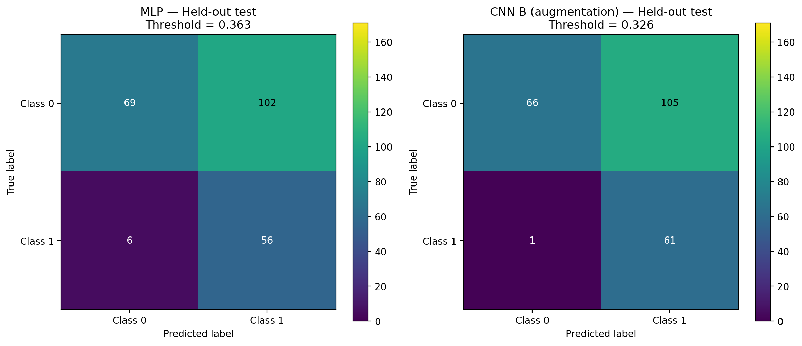

# Kepler exoplanet candidate classification

This course project asks whether a compact convolutional model using phase-folded flux curves improves screening over models using seven engineered Kepler features.

| File or directory | Contents |
|---|---|
| [Notebook 01](01_exoplanet_eda.ipynb) | Data exploration, logistic regression, class weighting, threshold selection, and a feature-based MLP |
| [Notebook 02](02_exoplanet_cnn.ipynb) | CNN experiments and a paired held-out comparison with the refitted MLP |
| `script/` | Reusable input audit, metrics, model training, and the original curve processing script |
| `execution/run.sh` | Entry point for either neural network experiment |
| `data/` | [Instructions for placing the local input files](data/README.md) |
| [`figures/`](figures/) | Figures from both executed notebooks |
| `mlp_results/`, `cnn_results/` | Local run artifacts |

Use the existing course environment or install the direct dependencies in `requirements.txt` in a Python 3.10 environment. Open the notebooks with the project root as their working directory.

```bash
bash execution/run.sh mlp
bash execution/run.sh cnn
```

The launcher uses `python3` from the active environment or the interpreter supplied in `PYTHON`. Each command accepts `--data-dir` and `--output-dir`. The MLP command reproduces Notebook 01’s validation run in `mlp_results/`. The CNN command writes a fresh reproduction to `cnn_results/reproduction/`. Notebook 02 writes its run to `cnn_results/notebook_run/`. Rerunning a command replaces files in its output directory. Use a different output directory to retain separate runs.

Notebook 02 filters the original stellar split using the curve and label audit. It trains the feature models and CNNs on the same eligible training stars, selects thresholds on the same validation stars, and scores the final CNN alongside the feature baselines on the same held-out stars. This comparison uses a freshly fitted MLP with the architecture from Notebook 01 and the validation F2 rule used for every model in Notebook 02.

Git ignores the supplied datasets and local experiment artifacts, including `cnn_results/`. The notebooks contain the full results and analysis.

## Held-out results

The refitted MLP and the selected CNN were evaluated on the same 233 stars, including 62 positives, at cutoffs chosen on validation.

| Model | Positives found | False positives | Average precision | F2 |
|---|---:|---:|---:|---:|
| MLP | 56 / 62 | 102 | 0.570 | 0.690 |
| Augmented CNN | 61 / 62 | 105 | 0.526 | 0.737 |

The paired 95% intervals for differences in ROC-AUC, average precision, and F2 contain zero. [Notebook 02](02_exoplanet_cnn.ipynb) explains the recall trade-off and the limits of this comparison.



## Figure index

| Analysis | Downloadable PNGs |
|---|---|
| Data exploration | [Class balance](figures/eda_class_distribution.png) · [Period distributions](figures/eda_period_by_class.png) · [Feature correlations](figures/eda_feature_correlations.png) |
| Logistic regression ranking | [Validation ROC](figures/logreg_validation_roc.png) · [Validation precision–recall](figures/logreg_validation_precision_recall.png) |
| Experiment A, cutoff 0.5 | [Unweighted matrix](figures/logreg_validation_confusion_matrix.png) · [Weighted matrix](figures/weighted_logreg_validation_confusion_matrix.png) |
| Experiment B, validation F2 | [Unweighted matrix](figures/logreg_validation_f2_confusion_matrix.png) · [Weighted matrix](figures/weighted_logreg_validation_f2_confusion_matrix.png) |
| Feature-based MLP | [Training history](figures/mlp_training_history.png) · [Feature-model precision–recall comparison](figures/feature_models_validation_precision_recall.png) · [Validation confusion matrix](figures/mlp_validation_f2_confusion_matrix.png) |
| CNN inputs | [Training light curves](figures/cnn_training_light_curve_examples.png) · [Training augmentation example](figures/cnn_augmentation_example.png) |
| CNN model selection | [Training histories](figures/cnn_mlp_training_histories.png) · [Validation confusion matrices](figures/cnn_validation_confusion_matrices.png) |
| Matched held-out comparison | [Confusion matrices](figures/cnn_mlp_test_confusion_matrices.png) · [ROC and precision–recall](figures/cnn_selected_test_roc_precision_recall.png) |
